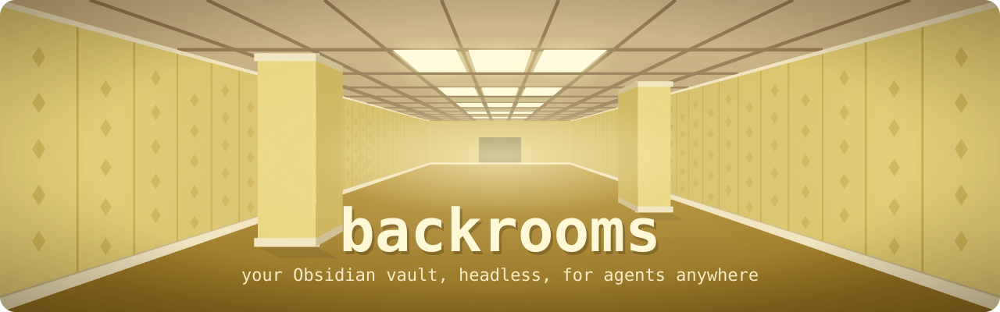

<p align="center"></p>

# backrooms

A headless server for an Obsidian vault. backrooms works on a git clone of the vault and implements a subset of the
Obsidian CLI without the Obsidian app, so agents can read, search and edit the vault from anywhere, for example from the
Claude app on a phone through MCP.

- [docs/vision.md](docs/vision.md) explains why backrooms exists and what it is for.
- [docs/obsidian-cli-coverage.md](docs/obsidian-cli-coverage.md) lists the Obsidian CLI features backrooms needs.
- [docs/compatibility.md](docs/compatibility.md) says which commands backrooms implements, how they are checked against
  Obsidian, and where backrooms deliberately differs.
- [docs/adr/](docs/adr/) holds the architecture decisions.

## Install

backrooms runs on [Bun](https://bun.sh):

```bash
bun add -g @felixscherz/backrooms   # or run it once with: bunx @felixscherz/backrooms help
```

## Usage

backrooms takes the same commands and `key=value` parameters as the Obsidian CLI:

```bash
cd ~/notes                      # or: export BACKROOMS_VAULT=~/notes
backrooms search query="pizza"
backrooms backlinks path="Note.md" format=json counts
backrooms property:set path="Note.md" name=last_reviewed value=2026-10-21 type=date
backrooms rename path="Old.md" name="New"
backrooms help                   # every command with its parameters
```

The vault is the folder in `BACKROOMS_VAULT`, or the nearest folder at or above the current one that contains a
`.obsidian` folder. `vault=<name>` is accepted and ignored, since backrooms serves one vault.

Commands that only make sense with the app running, such as `open` or `command`, fail with an error that says they are
not supported.

### Commands backrooms adds

- `edit path=<path> old=<text> new=<text> [all]` replaces an exact piece of text. The text has to occur exactly once
  unless `all` is set. A remote agent cannot edit files itself, so this replaces the file edits an agent makes on a
  local vault.
- `file path=<path>` prints a `version`. Pass it as `version=<version>` to `edit`, `append`, `prepend`, `delete` or
  `create ... overwrite` and the write is rejected if the file changed since. `create ... overwrite` requires it.
- `git:status`, `git:log [limit=<n>] [path=<path>]`, `git:show commit=<id>` and `git:revert commit=<id>` let an agent
  look at and undo what backrooms changed.

### Writes

Every write goes through one write path (ADR 2): only the intended bytes change, each file is replaced atomically,
multi-file changes such as a rename roll back if they fail part way, deleted notes go to `.trash/`, and backrooms never
touches `.obsidian/` or other hidden folders. A rename or move that would make any link point at a different file is
rejected. A write that fails says whether the vault was left unchanged or names the files it could not restore.

Several backrooms processes on one vault, such as the MCP server and a CLI run, take turns: a write holds a lock file in
`.git/`, or in the system's temporary folder when the vault is not a git repository, while it runs. A lock left by a process that ended is taken over, and a write gives up
with a `busy` error after waiting 10 seconds for a lock that a running process holds.

### Plugins

backrooms reimplements some features of community plugins and applies them when the vault enables the plugin, with the
plugin's own settings from `.obsidian/plugins/<id>/data.json` (ADR 7). A note is linted when a command creates or
changes it, not when it is only renamed, moved or deleted. Like the Linter, backrooms only lints when the Linter lints on
save or on leaving a note, or updates timestamps as a note changes, and leaves the folders and files it ignores alone.

| Plugin | What backrooms does |
| --- | --- |
| Linter (`obsidian-linter`) | The `yaml-timestamp` rule: records when a note was created and last modified in its frontmatter |

Timestamps are written in the local time of the process, so set `TZ` on a server. A note without a creation date gets
the date git first saw it, or the file system's date outside git. When the Linter's settings ask for something backrooms
cannot do the same way, such as a date format with month names, writes fail with an error.

### Git

| `BACKROOMS_GIT` | Behavior |
| --- | --- |
| `off` (default) | backrooms does not touch git. `git:status`, `git:log` and `git:show` still work in a repository. |
| `commit` | Every write becomes one commit of exactly the files it touched. |
| `sync` | Also fetches and rebases before each write and every minute in the MCP server, and pushes after each commit. |

`BACKROOMS_PULL_INTERVAL` sets how many seconds the MCP server waits between pulls in `sync` mode (default 60).

A rebase that conflicts is aborted. backrooms keeps its local commits, stops syncing and reports it in `git:status` and
as a warning after each write, until a human resolves it.

### MCP

`backrooms mcp` serves the vault over stdio with ten tools designed for agents (ADR 9), rather than one per CLI
command: `search`, `list`, `read`, `vault` and `history` read, `create`, `edit`, `move`, `delete` and `undo` write.
They take typed arguments, name a note by its path or its name as `note`, and return JSON. `edit` applies several
changes as one write and one commit. Content is taken literally, without the `\n` escapes the shell needs.

The server's instructions tell the agent how the tools work together. When the vault has a note `AGENTS.md` at its
root, its text is added to them, so the vault's conventions, such as how notes are named, reach the agent without
exploring the vault. A client sees a change to it the next time it connects.

```json
{
  "mcpServers": {
    "backrooms": { "command": "backrooms", "args": ["mcp"], "env": { "BACKROOMS_VAULT": "/srv/notes" } }
  }
}
```

### Remote MCP with OAuth

`backrooms serve` serves the same tools over streamable HTTP at `/mcp`, for the Claude apps and Claude Code on other
devices. backrooms is its own OAuth server for one person who signs in with a passphrase (ADR 8). Run it behind a
reverse proxy that terminates TLS.

```sh
backrooms auth:hash < passphrase.txt   # prints the hash for BACKROOMS_PASSPHRASE_HASH; use 16 or more characters
```

| Variable | Meaning |
| --- | --- |
| `BACKROOMS_URL` | Public origin, such as `https://backrooms.example.com`. Required, https unless it is localhost |
| `BACKROOMS_PASSPHRASE_HASH` | Output of `backrooms auth:hash`. Required |
| `BACKROOMS_LISTEN` | Local address to listen on, default `127.0.0.1:8484` |
| `BACKROOMS_STATE` | Folder for the sign-in database, default `$XDG_STATE_HOME/backrooms` or `~/.local/state/backrooms` |
| `BACKROOMS_CLIENT_ORIGINS` | Comma-separated origins whose clients may sign in, default `https://claude.ai` |

In Claude, add a custom connector with the URL `BACKROOMS_URL/mcp` and the default authentication settings. Claude
opens backrooms' sign-in page, which names the client asking, and you enter the passphrase. Tokens last an hour and
are refreshed for up to 30 days of not being used. `backrooms auth:revoke` ends every sign-in. Five wrong passphrases
in a row pause sign-in for 15 minutes.

## Development

backrooms is written in TypeScript and runs on [Bun](https://bun.com).

```bash
bun install
bun test
bun run typecheck
bun run format
bun run build                   # single executable in dist/backrooms
```

The tests drive the CLI against temporary vaults on disk, and the git tests use real repositories with a bare remote.
`compat/compat.test.ts` checks that backrooms answers like the Obsidian CLI on [test-vault/](test-vault/), against
answers recorded with `bun compat/record.ts` (see [docs/compatibility.md](docs/compatibility.md)).
`compat/linter.test.ts` does the same for the Linter plugin on `compat/linter-vault/`, recorded with
`bun compat/record-linter.ts`.

## License

[MIT](LICENSE)
